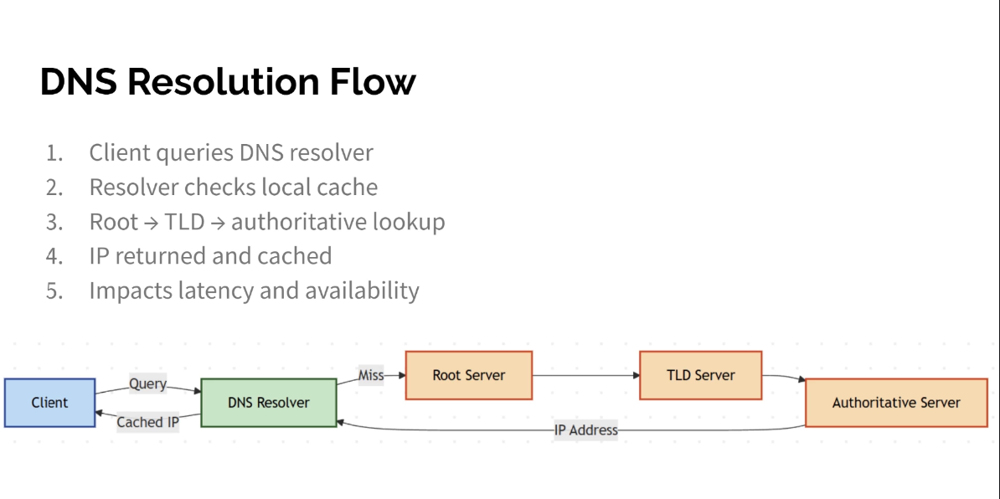

# DHCP and DNS
- DHCP: gives a device its IP configuration automatically
- DNS: translates names (example.com) into IP addresses
- Together they let a device join a network and reach things by name with no manual setup

## DHCP (Dynamic Host Configuration Protocol)
- Hands out: IP address, subnet mask, default gateway, DNS servers, lease time
- Uses UDP: server port 67, client port 68
- Scope (pool): the range of addresses the server may hand out
- Lease: the address is lent for a limited time, the client renews at 50% of the lease
- Reservation: a fixed address always given to the same MAC address
- Exclusions: addresses in the scope kept for static devices (servers, printers)
- No DHCP answer: the client self-assigns an APIPA address (169.254.x.x)

## DHCP process (DORA)

| Step | Message | Direction | Meaning |
|------|---------|-----------|---------|
| 1 | Discover | client → broadcast | "is there a DHCP server?" |
| 2 | Offer | server → client | "you can have this address" |
| 3 | Request | client → broadcast | "I'll take that one" |
| 4 | Acknowledge | server → client | "it's yours for the lease time" |

- Broadcasts do not cross routers: a DHCP relay agent (IP helper) forwards requests to a server on another subnet

## DNS (Domain Name System)
- Hierarchical, distributed database of names
- Uses port 53: UDP for normal queries, TCP for large responses and zone transfers
- Hierarchy: root (.) → top-level domain (.com) → domain (example.com) → host (www)
- FQDN: the full name, e.g. www.example.com.

## DNS resolution flow
1. Client checks its own cache and hosts file
2. Client asks its recursive resolver (from DHCP, e.g. the ISP or 8.8.8.8)
3. Resolver asks a root server, which points to the TLD servers
4. Resolver asks the TLD server, which points to the domain's authoritative server
5. Authoritative server returns the record
6. Resolver caches the answer for its TTL and returns it to the client

## DNS record types

| Record | Purpose |
|--------|---------|
| A | name → IPv4 address |
| AAAA | name → IPv6 address |
| CNAME | alias → another name |
| MX | mail server for the domain |
| NS | authoritative name servers for the zone |
| PTR | IP address → name (reverse lookup) |
| TXT | free text (SPF, domain verification) |
| SOA | zone settings and primary server |
| SRV | location (host and port) of a service |

## Troubleshooting
- `ipconfig /all`: show the address, gateway, DNS and DHCP server
- `ipconfig /release` and `ipconfig /renew`: get a new lease
- `ipconfig /flushdns`: clear the local DNS cache
- `nslookup example.com` or `dig example.com`: query DNS directly
- Ping by IP works but by name fails: it's a DNS problem
- Address is 169.254.x.x: DHCP is unreachable

https://en.wikipedia.org/wiki/Dynamic_Host_Configuration_Protocol

https://en.wikipedia.org/wiki/Domain_Name_System
