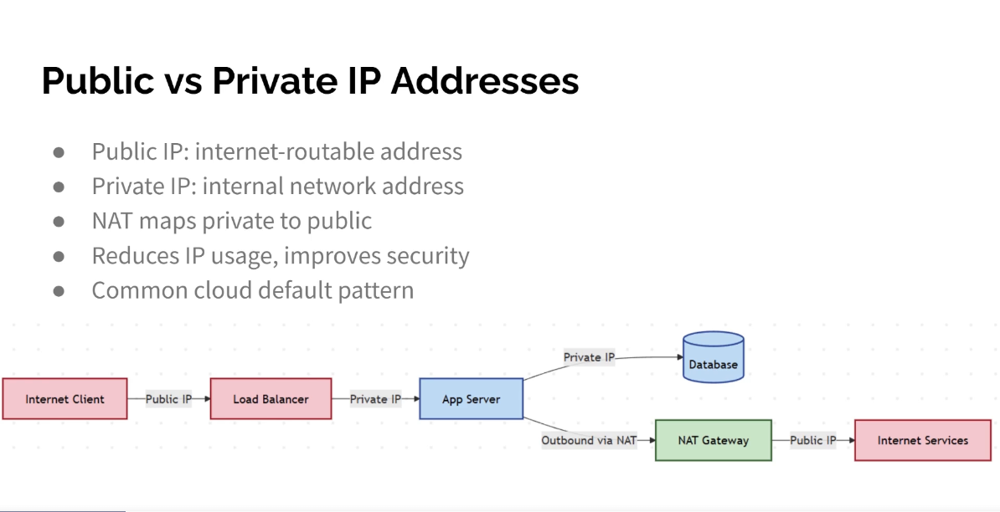

# Overview of IPv4
- IPv4: Internet Protocol version 4, the layer 3 protocol that addresses and routes packets
- Address: 32 bits, about 4.3 billion addresses in total
- Connectionless and best effort: no delivery guarantee, reliability is left to TCP

## Address format
- Written as 4 decimal numbers (octets) separated by dots: 192.168.1.10
- Each octet is 8 bits, value 0–255
- 192.168.1.10 = 11000000.10101000.00000001.00001010
- Two parts: network portion (which network) and host portion (which device on it)

## Subnet mask
- Marks where the network portion ends: 1 bits = network, 0 bits = host
- 255.255.255.0 = /24 in CIDR notation = first 24 bits are the network
- Network address: all host bits 0 (192.168.1.0), identifies the network itself
- Broadcast address: all host bits 1 (192.168.1.255), reaches every host on the network
- Usable hosts = 2^(host bits) − 2, so a /24 has 254

## Address classes (historical)

| Class | First octet | Default mask | Use |
|-------|-------------|--------------|-----|
| A | 1–126 | /8 (255.0.0.0) | very large networks |
| B | 128–191 | /16 (255.255.0.0) | medium networks |
| C | 192–223 | /24 (255.255.255.0) | small networks |
| D | 224–239 | – | multicast |
| E | 240–255 | – | experimental |

- Classes were replaced by CIDR (classless addressing), which allows any prefix length

## Public and private addresses

| Range | CIDR | Class |
|-------|------|-------|
| 10.0.0.0 – 10.255.255.255 | 10.0.0.0/8 | A |
| 172.16.0.0 – 172.31.255.255 | 172.16.0.0/12 | B |
| 192.168.0.0 – 192.168.255.255 | 192.168.0.0/16 | C |

- Private (RFC 1918): free to use inside any network, not routed on the internet
- Public: globally unique, assigned by IANA and the regional registries through ISPs
- NAT translates private addresses to a public one at the network edge

## Special addresses
- 127.0.0.0/8: loopback, 127.0.0.1 is "this device"
- 169.254.0.0/16: APIPA (link-local), self-assigned when DHCP fails
- 0.0.0.0: "no address yet" or the default route
- 255.255.255.255: broadcast on the local network

## Types of communication
- Unicast: one to one
- Broadcast: one to all on the local network
- Multicast: one to a group

## Assigning addresses
- Static: set by hand, for servers, printers, network devices
- Dynamic: handed out by DHCP, for clients
- A host needs: IP address, subnet mask, default gateway, DNS server

## IPv4 header (key fields)
- Source and destination IP address
- TTL: decreased by 1 at each router, the packet is dropped at 0 (prevents endless loops)
- Protocol: what is carried inside (6 = TCP, 17 = UDP, 1 = ICMP)
- Header checksum, fragmentation fields, total length

## Limits
- Address exhaustion: 4.3 billion is not enough, eased by NAT, CIDR and private ranges
- Long-term fix is IPv6 (128-bit addresses)

https://en.wikipedia.org/wiki/IPv4
