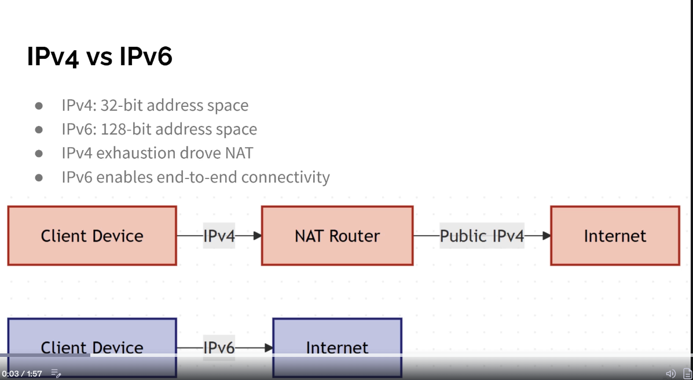

# IPv6
- IPv6: Internet Protocol version 6, the successor to IPv4
- Address: 128 bits, about 3.4 × 10^38 addresses
- Built to solve IPv4 address exhaustion; every device can have a public address, so NAT is not needed

## Address format
- 8 groups of 4 hexadecimal digits separated by colons
- 2001:0db8:0000:0000:0000:ff00:0042:8329
- Each group (hextet) is 16 bits
- Prefix length is written in CIDR style: 2001:db8::/32

## Shortening rules
1. Drop leading zeros in each group: 0db8 → db8, 0042 → 42, 0000 → 0
2. Replace one run of consecutive all-zero groups with `::` (only once per address)

- 2001:0db8:0000:0000:0000:ff00:0042:8329 → 2001:db8::ff00:42:8329
- `::` may be used only once, otherwise the length of each gap would be unknown

## Address structure
- First 64 bits: network prefix (global routing prefix + subnet ID)
- Last 64 bits: interface ID (the host)
- Standard subnet size is /64
- Typical allocation: ISP gets /32, a site gets /48 (65,536 subnets), each LAN gets /64

## Address types

| Type | Prefix | IPv4 equivalent |
|------|--------|-----------------|
| Global unicast | 2000::/3 | public address |
| Unique local | fc00::/7 (fd00::/8 in practice) | private address |
| Link-local | fe80::/10 | APIPA, but always present on every interface |
| Multicast | ff00::/8 | multicast and broadcast |
| Loopback | ::1 | 127.0.0.1 |
| Unspecified | :: | 0.0.0.0 |
| Documentation | 2001:db8::/32 | example ranges |

- Unicast: one to one
- Multicast: one to a group (ff02::1 = all nodes, ff02::2 = all routers)
- Anycast: one to the nearest of several devices sharing an address
- No broadcast in IPv6, multicast does that job

## How a host gets an address
- SLAAC (stateless autoconfiguration): the host takes the /64 prefix from a router advertisement and generates its own interface ID
- Interface ID: random (privacy extensions) or EUI-64 (built from the MAC address)
- DHCPv6: stateful (server assigns the address) or stateless (SLAAC address, DHCPv6 only for DNS and options)
- Static: set by hand
- An interface normally has several addresses: one link-local plus one or more global

## Neighbor Discovery Protocol (NDP)
- Runs over ICMPv6, replaces ARP
- Neighbor solicitation / advertisement: find the MAC address of a neighbour
- Router solicitation / advertisement: find routers and the network prefix
- Duplicate address detection: check an address is free before using it
- ICMPv6 is essential in IPv6, blocking it completely breaks the network

## IPv4 vs IPv6

| | IPv4 | IPv6 |
|---|------|------|
| Address size | 32 bits | 128 bits |
| Notation | dotted decimal | hexadecimal with colons |
| Header | variable, 20–60 bytes | fixed, 40 bytes, simpler |
| Broadcast | yes | no, multicast instead |
| Address resolution | ARP | NDP (ICMPv6) |
| Configuration | static or DHCP | SLAAC, DHCPv6 or static |
| NAT | widely needed | not needed |
| Fragmentation | routers and sender | sender only |
| Header checksum | yes | no |
| IPsec | optional | built into the design |

## Transition methods
- Dual stack: devices run IPv4 and IPv6 side by side (the most common)
- Tunneling: IPv6 packets carried inside IPv4 (6to4, Teredo, GRE)
- Translation: NAT64 with DNS64 lets IPv6-only clients reach IPv4 servers
- IPv4 and IPv6 are not directly compatible

## Commands
- `ipconfig` (Windows) or `ip -6 addr` (Linux): show IPv6 addresses
- `ping -6 host` or `ping6 host`: test IPv6 reachability
- In a URL the address goes in brackets: http://[2001:db8::1]:8080/

https://en.wikipedia.org/wiki/IPv6
