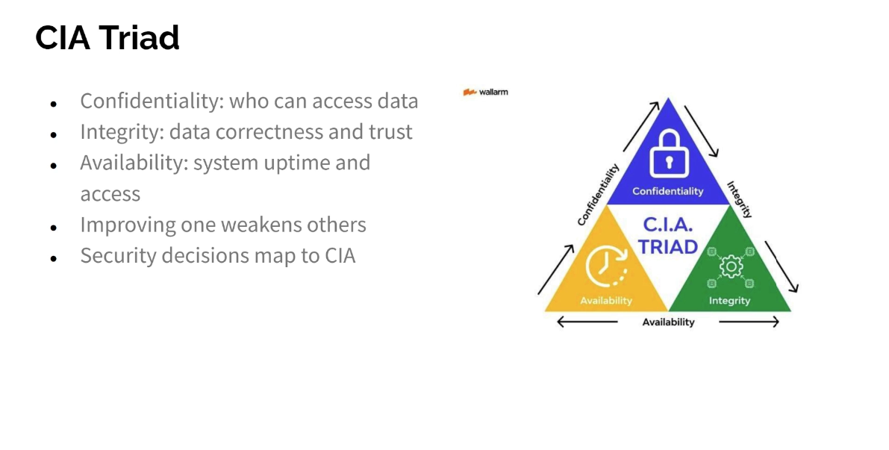

# CIA
- CIA triad: Confidentiality, Integrity, Availability, the three goals of information security
- Every control protects at least one of them; every attack damages at least one
- Used to classify assets, judge risks and choose controls

## Overview

| | Confidentiality | Integrity | Availability |
|---|-----------------|-----------|--------------|
| Question | who can see it? | can it be trusted? | can it be reached? |
| Goal | no unauthorized disclosure | no unauthorized change | access when needed |
| Opposite (DAD) | disclosure | alteration | destruction / denial |
| Main tools | encryption, access control | hashing, signatures | redundancy, backups |

## Confidentiality
- Only authorized people, devices and processes can read the data
- Threats: sniffing unencrypted traffic, stolen or weak credentials, phishing, misconfigured shares and cloud storage, lost laptops, shoulder surfing, insiders

| Control | Example |
|---------|---------|
| Encryption in transit | TLS/HTTPS, SSH, IPsec VPN, WPA3 |
| Encryption at rest | BitLocker, LUKS, database encryption |
| Authentication | strong passwords, MFA, certificates |
| Access control | permissions, roles, least privilege, ACLs |
| Segmentation | VLANs, firewalls, DMZ |
| Data classification | public, internal, confidential, secret |
| Physical | locked rooms, screen locks, secure disposal |

## Integrity
- Data is accurate, complete and changed only by authorized parties, in transit and at rest
- Also covers knowing where data came from (authenticity)
- Threats: man-in-the-middle tampering, malware modifying files, unauthorized configuration changes, SQL injection, human error, transmission and disk errors

| Control | Example |
|---------|---------|
| Hashing | SHA-256 checksum of a download or file |
| Message authentication | HMAC: a hash combined with a secret key |
| Digital signatures | signed software, signed email, certificates |
| Checksums in protocols | Ethernet FCS, TCP checksum (detect accidental errors only) |
| Access control | write permissions, separation of duties |
| Change tracking | version control, audit logs, file integrity monitoring |
| Backups | restore a known good copy |

- A hash changes completely if one bit of the input changes
- Hash alone detects accidental change; a signature or HMAC also detects deliberate change

## Availability
- Systems, networks and data are usable when authorized users need them
- Threats: DoS and DDoS, ransomware, hardware failure, power or link outage, misconfiguration, failed updates, natural disasters

| Control | Example |
|---------|---------|
| Redundancy | dual power supplies, RAID, two ISPs, redundant switches and routers |
| Failover | clustering, HSRP/VRRP for gateways, load balancers |
| Backups | 3-2-1 rule, tested restores |
| Power | UPS, generator |
| Capacity | monitoring, scaling, QoS |
| Protection | DDoS mitigation, rate limiting, firewalls |
| Maintenance | patching, monitoring, spare parts |
| Planning | disaster recovery and business continuity plans |

- Measured as uptime: 99.9% ("three nines") = about 8.8 hours of downtime a year; 99.99% = about 53 minutes
- RTO: how fast service must be restored; RPO: how much recent data may be lost
- Single point of failure: a component whose failure stops everything

## Trade-offs
- The three goals pull against each other; the balance depends on the system

| More of | Can cost |
|---------|----------|
| Confidentiality (encryption, MFA, strict access) | availability and ease of use |
| Integrity (checks, approvals, signing) | speed and availability |
| Availability (copies, open access, replication) | confidentiality and consistency |

| System | Priority |
|--------|----------|
| Medical records, trade secrets | confidentiality |
| Banking transactions, software updates | integrity |
| Emergency services, online shop, industrial control | availability |

## Attacks by what they break

| Attack | C | I | A |
|--------|---|---|---|
| Sniffing / eavesdropping | ✔ | | |
| Data breach | ✔ | | |
| Man in the middle | ✔ | ✔ | |
| Website defacement | | ✔ | |
| DNS poisoning | | ✔ | |
| DDoS | | | ✔ |
| Ransomware | ✔ (often) | ✔ | ✔ |
| Cut cable, power failure | | | ✔ |

## Beyond the triad
- Authentication: proving identity
- Authorization: what an identity may do
- Accounting: recording what was done
- Non-repudiation: the sender cannot deny having sent it (digital signatures)
- Authenticity: the data really comes from who it claims
- Parkerian hexad: adds possession, authenticity and utility to CIA

https://en.wikipedia.org/wiki/Information_security#CIA_triad
